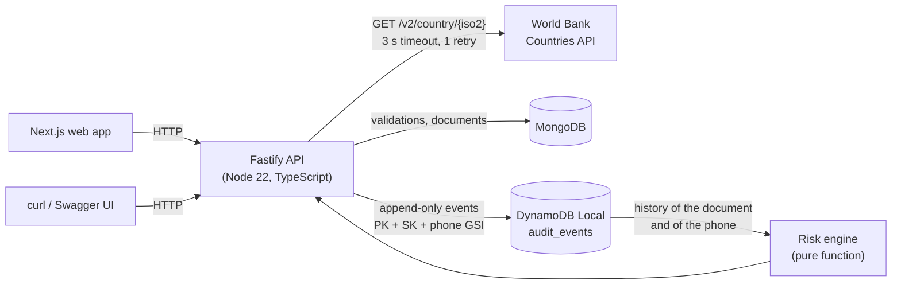
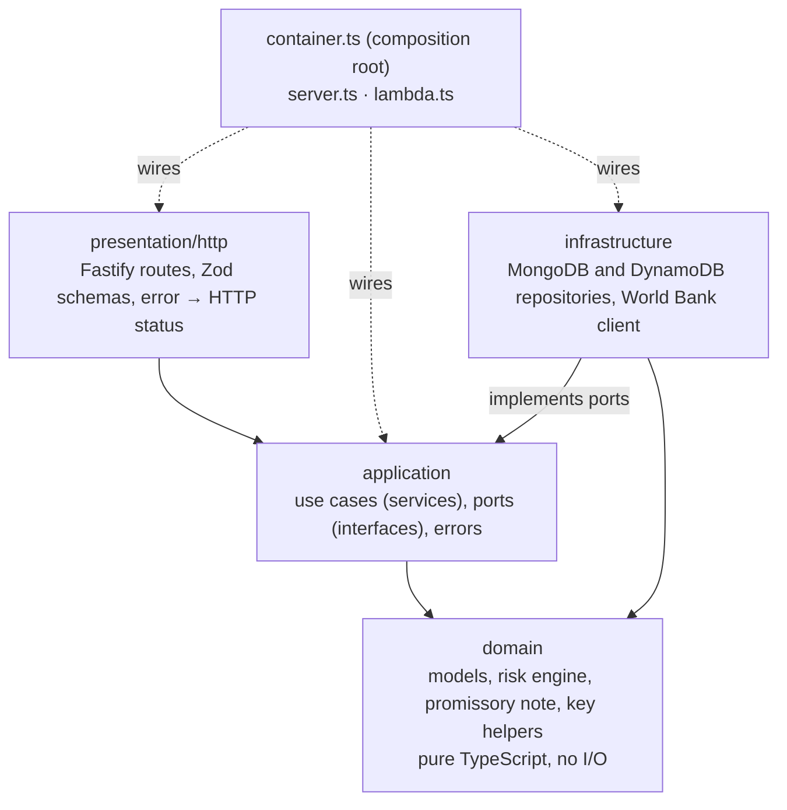
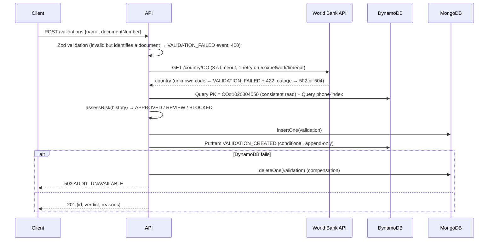
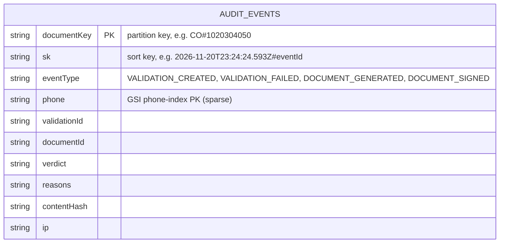

# Identity validation service

[Español](README.md) · **English**

Technical test for AUCO (Full Stack, Node.js). A Node.js service that validates a person, enriches the record with public country data, stores it in **MongoDB** and writes an append-only audit trail to **DynamoDB Local**.

On top of the required endpoints it grows into a small "digital notary", inspired by the path AUCO itself followed: **validate → assess risk → generate a document → sign → audit**. Everything beyond the exercise is optional, has its own tests, and does not change the required contract.

| Required by the exercise | Where |
|---|---|
| `POST /validations`: name + document → public API → MongoDB → id | [`validation-service.ts`](api/src/application/validation-service.ts) |
| `GET /validations/:id` | same |
| Audit event in DynamoDB Local keyed by document and date | [`dynamo-audit-repository.ts`](api/src/infrastructure/persistence/dynamo-audit-repository.ts) |
| Input validation | Zod schemas, [`schemas.ts`](api/src/presentation/http/schemas.ts) |
| External API error handling | [`world-bank-countries-client.ts`](api/src/infrastructure/countries/world-bank-countries-client.ts) |
| At least 3 automated tests | 66 unit/HTTP tests + 5 integration tests against real MongoDB and DynamoDB |
| README | this file |

| Extra | Where |
|---|---|
| Safe retries with the `Idempotency-Key` header | [`idempotency-service.ts`](api/src/application/idempotency-service.ts) |
| Risk engine (APPROVED / REVIEW / BLOCKED) over the audit trail | [`risk-engine.ts`](api/src/domain/risk-engine.ts) |
| Promissory note with tamper-evident signature | [`document-service.ts`](api/src/application/document-service.ts) |
| Audit timeline endpoint | [`audit-routes.ts`](api/src/presentation/http/routes/audit-routes.ts) |
| Mobile-first Next.js front end for the whole flow, in English and Spanish, light and dark | [`web/`](web) |
| OpenAPI docs, CI, Lambda entry point, demo script | `/docs`, [`.github/workflows`](.github/workflows/ci.yml), [`lambda.ts`](api/src/lambda.ts), [`scripts/demo.sh`](scripts/demo.sh) |

## Quick start

Requirements: Docker with Compose. Internet access (the service calls the World Bank API).

```bash
docker compose up --build
```

| What | URL |
|---|---|
| Web app | http://localhost:3001 |
| API | http://localhost:3000 |
| OpenAPI / Swagger UI | http://localhost:3000/docs |
| Health (checks MongoDB and the DynamoDB table) | http://localhost:3000/health |

A port is taken? Every host port is configurable:

```bash
API_PORT=3100 WEB_PORT=3101 MONGO_PORT=27019 DYNAMO_PORT=8002 docker compose up --build
```

Then take the tour (every scenario, including the error cases):

```bash
scripts/demo.sh                          # or: scripts/demo.sh http://localhost:3100
```

## Architecture



### Layers

The API follows a layered architecture (ports and adapters). Dependencies only point inwards, and **ESLint enforces it** (`no-restricted-imports` per layer in [`eslint.config.js`](api/eslint.config.js)): a forbidden import fails the lint and the CI.



| Layer | Knows | Must not import |
|---|---|---|
| `domain/` | nothing but itself | any other layer, Fastify, MongoDB, AWS SDK, Zod |
| `application/` | domain | infrastructure, presentation, any framework or database |
| `presentation/http/` | application, domain | infrastructure, MongoDB, AWS SDK |
| `infrastructure/` | application ports and errors, domain | presentation, Fastify |

- **Application errors carry a code, not an HTTP status.** Only [`error-handler.ts`](api/src/presentation/http/error-handler.ts) maps them to 404, 409, 422, 502, 503 or 504.
- **Ports** ([`ports.ts`](api/src/application/ports.ts)) are what the use cases need: repositories, the countries client, the idempotency store and a logger. Infrastructure implements them; tests implement them in memory.
- **Composition root** ([`container.ts`](api/src/container.ts)) is the only module that knows every layer. That is why swapping REST Countries for the World Bank API touched one adapter, why the tests run the real app with in-memory fakes in under a second, and why [`lambda.ts`](api/src/lambda.ts) runs the same app behind API Gateway with `@fastify/aws-lambda` (not deployed in this exercise).

## API

| Method | Path | What it does |
|---|---|---|
| `POST` | `/validations` | Validate, enrich, assess risk, store, audit. `201 {id, verdict, reasons}` |
| `GET` | `/validations/:id` | The stored record |
| `GET` | `/audit/:countryCode/:documentNumber` | Every audit event of a document, oldest first |
| `POST` | `/validations/:id/promissory-notes` | Generate a demo promissory note (APPROVED only) |
| `POST` | `/documents/:id/sign` | Sign it (time, IP, user agent, hash check) |
| `GET` | `/documents/:id` | The document, its hash and signature |
| `GET` | `/health` | MongoDB ping and DynamoDB table check |

### `POST /validations`

```bash
curl -X POST localhost:3000/validations \
  -H 'content-type: application/json' \
  -d '{"name": "Ana Gómez", "documentNumber": "1020304050"}'
# 201 {"id":"6b00d6a86152ee9615a08a52","verdict":"APPROVED","reasons":[]}
```

| Field | Required | Rules |
|---|---|---|
| `name` | yes | 2–100 characters, trimmed |
| `documentNumber` | yes | 5–20 letters or digits; `.`, `-` and spaces are removed (`1.020.304.050` → `1020304050`) |
| `countryCode` | no, default `CO` | ISO 3166-1 alpha-2; used to enrich the record |
| `phone` | no | E.164, e.g. `+573001234567`; feeds the shared-phone signal |

The exercise asks for *name and document*, so those are the only required fields: `curl` with exactly those two works. Country and phone are optional extras.

#### Safe retries: `Idempotency-Key`

A network retry or a double click must not create two validations (nor two audit events). Send an `Idempotency-Key` header, any client-generated unique string such as a UUID, following the IETF draft *The Idempotency-Key HTTP Header Field*:

```bash
KEY=$(uuidgen)
curl -X POST localhost:3000/validations -H "Idempotency-Key: $KEY" \
  -H 'content-type: application/json' -d '{"name": "Ana Gómez", "documentNumber": "1020304050"}'
# Same request again: same id, header "Idempotent-Replayed: true", nothing new is written
```

| Situation | Response |
|---|---|
| Same key, same body (after normalization: `1.020.304.050` = `1020304050`) | The first response again, `Idempotent-Replayed: true` |
| Same key, different body | `422 IDEMPOTENCY_KEY_REUSED` |
| Same key while the first request is still running (double click) | `409 IDEMPOTENCY_REQUEST_IN_PROGRESS` |
| The operation failed (e.g. 502) | The key is released, so the client can retry with it |
| No header | Normal behaviour: every request creates a validation |

Keys live in MongoDB: the claim is an atomic `insertOne` on a unique `_id` (of two simultaneous requests exactly one wins), a TTL index removes keys after 24 hours, and a claim abandoned for 30 s (a crashed process) can be taken over. The web app sends a new key per attempt and reuses it when the user retries the same data.

### `GET /validations/:id`

```json
{
  "id": "6b00d6a86152ee9615a08a52",
  "name": "Ana Gómez",
  "documentNumber": "1020304050",
  "countryCode": "CO",
  "phone": null,
  "country": {
    "code": "CO",
    "name": "Colombia",
    "region": "Latin America & Caribbean",
    "incomeLevel": "Upper middle income",
    "capital": "Bogota"
  },
  "risk": { "verdict": "APPROVED", "reasons": [] },
  "createdAt": "2026-11-20T23:24:24.593Z"
}
```

Country data comes in English because that is how the World Bank returns it.

### Errors

Every error has the same shape: `{"error": {"code": "...", "message": "...", "details": [...]}}`, and every response carries an `x-request-id` header that also appears in the logs.

| Status | Code | When |
|---|---|---|
| 400 | `VALIDATION_ERROR` | Invalid body or id, with per-field `details` |
| 404 | `NOT_FOUND` | No validation or document with that id |
| 409 | `VALIDATION_NOT_APPROVED`, `ALREADY_SIGNED`, `DOCUMENT_TAMPERED` | Document rules |
| 409 | `IDEMPOTENCY_REQUEST_IN_PROGRESS` | Same `Idempotency-Key` still being processed |
| 422 | `COUNTRY_NOT_FOUND` | The countries API does not recognize the code |
| 422 | `IDEMPOTENCY_KEY_REUSED` | Same `Idempotency-Key` with a different body |
| 502 | `UPSTREAM_UNAVAILABLE` | Countries API failed (after one retry) |
| 503 | `AUDIT_UNAVAILABLE` | DynamoDB failed; the MongoDB write was rolled back |
| 504 | `UPSTREAM_TIMEOUT` | Countries API took longer than 3 s (after one retry) |

## How a validation is created



**No validation without its audit event.** The id is generated before writing, the record goes to MongoDB, then the event to DynamoDB. If DynamoDB fails, the MongoDB insert is deleted and the API answers 503. A production system would use an outbox or DynamoDB Streams instead of a compensating delete (see *What I would improve*).

## DynamoDB key design



| Access pattern | How |
|---|---|
| Full history of a person's document, in order | `Query documentKey = :pk` (one partition, sorted by `sk`) |
| Events in a time range | `Query documentKey = :pk AND sk BETWEEN :from AND :to` |
| Every document that used a phone | `Query` on GSI `phone-index` |
| Never overwrite an event | `PutItem` with `attribute_not_exists(documentKey) AND attribute_not_exists(sk)` |

- **PK `documentKey = "<country>#<document>"`**: the exercise asks for a key "by document". The country is part of it because the same number can belong to two different people in two countries (a Colombian *cédula* and a Peruvian *DNI*). All the events of one person live in one partition, which is exactly what the risk engine and the timeline read.
- **SK `sk = "<ISO-8601 timestamp>#<eventId>"`**: ISO timestamps sort lexicographically, so the partition comes back in chronological order and supports range queries. The `eventId` suffix keeps two events in the same millisecond from colliding. Events inside one millisecond are treated as concurrent: their relative order is not meaningful.
- **GSI `phone-index`** (PK `phone`, SK `sk`) serves the "same phone, several people" signal. It is sparse: only events with a phone are indexed.
- **Consistency**: the document history uses `ConsistentRead`, so the engine always sees the previous event. GSIs only support eventually consistent reads, which is acceptable for a REVIEW signal.
- DynamoDB Local persists to a Docker volume: an audit trail must survive restarts.

## Risk engine

A pure function in the domain layer ([`risk-engine.ts`](api/src/domain/risk-engine.ts)): it receives the history already read from DynamoDB and returns a verdict with human-readable reasons. The rules are inspired by the fraud signals AUCO published in September 2026.

| Signal | Rule | Verdict |
|---|---|---|
| `DOCUMENT_NAME_MISMATCH` | The document was validated before under another name (case and accents ignored) | `REVIEW` |
| `SHARED_PHONE` | The phone is linked to other documents | `REVIEW`, `BLOCKED` at 3 |
| `REPEATED_FAILURES` | 3+ failed attempts for the document in the last 24 h | `BLOCKED` |

The most severe verdict wins, and every reason is returned. A *failed attempt* is a request that identifies a document (valid number and country) but fails validation, or uses a country that does not exist. Upstream outages are not the person's fault and are not counted. Thresholds are arbitrary and live in one constant.

`REVIEW` and `BLOCKED` validations are still stored (traceability), but they cannot generate documents.

## Documents and signature

```bash
curl -X POST localhost:3000/validations/<validationId>/promissory-notes \
  -H 'content-type: application/json' \
  -d '{"amount": 1500000, "dueDate": "2027-06-30", "creditorName": "Banco Demo S.A."}'
curl -X POST localhost:3000/documents/<documentId>/sign
```

- The note is rendered with the validated identity. Currency defaults to COP, and the city to the capital returned by the countries API. It is in Spanish because it is a Colombian-style *pagaré*, and it is marked as a demo without legal value.
- Its SHA-256 is written to the **immutable audit trail** when it is generated. Signing recomputes the hash and compares it with the audit copy, not with the one stored next to the document. A document edited in MongoDB afterwards, even with its stored hash updated, is rejected with `409 DOCUMENT_TAMPERED`.
- `PENDING_SIGNATURE → SIGNED` is a conditional `updateOne`, so concurrent clicks cannot sign twice (`409 ALREADY_SIGNED`).
- The signature stores time, IP, user agent and the time since the validation (the web app shows it as a stopwatch).

## Web app

[`web/`](web) is a Next.js 16 + Tailwind 4 onboarding-style flow, one question per screen: country → identity → risk verdict → promissory note and signature → audit trail.

- **Mobile first:** base styles target phones (compact progress bar, sticky actions, 16 px inputs); from `lg` a side panel shows the steps.
- **English and Spanish:** typed dictionaries in [`lib/i18n`](web/lib/i18n). `es.ts` is typed as the shape of `en.ts`, so a missing or extra key fails the build. The first language comes from the browser and the choice is saved. API error messages stay in English: they are part of the API contract.
- **Light and dark:** colours are CSS variables switched by `data-theme` on `<html>`; the preference (light, dark or system) is saved, and a tiny inline script applies it before the first paint so there is no white flash.

## What is real and what is simulated

| Real | Simulated or out of scope |
|---|---|
| Input validation, World Bank enrichment, MongoDB, DynamoDB audit trail, risk rules, SHA-256 hash, signature record, idempotency | ID photo, liveness check, national registry and watch lists, WhatsApp/email delivery, cryptographic (PKI) signature, authentication |

## Tests

```bash
cd api && npm ci
npm test                 # 66 unit + HTTP tests, in-memory fakes, no Docker needed (< 1 s)
npm run lint && npm run typecheck

docker compose up -d mongo dynamodb
npm run test:e2e         # 5 integration tests against real MongoDB and DynamoDB Local
```

- **Unit:** schemas, countries client (payload mapping, unknown code, aggregates, retry, timeout, cache), risk rules, promissory note, idempotency.
- **HTTP** (`app.inject`, the real Fastify app with fakes): every status code above, the MongoDB rollback when DynamoDB fails, failed-attempt auditing, the document flow, tamper detection, idempotent retries and double clicks.
- **Integration:** chronological `Query` by partition key, the phone GSI, conditional writes that refuse to overwrite, only one winner among concurrent signatures, and only one winner among concurrent idempotency claims (plus the TTL index).
- CI (GitHub Actions) runs lint, typecheck, all tests with MongoDB and DynamoDB service containers, and both builds.

## Project layout

```
api/src/
  domain/                     models, risk engine, promissory note, audit key helpers (pure)
  application/                use cases: validation, documents, audit, idempotency; ports; errors
  infrastructure/
    countries/                World Bank client: timeout, retry, cache, error mapping
    persistence/              MongoDB and DynamoDB repositories, idempotency store (implement the ports)
  presentation/http/          Fastify app, routes, Zod schemas, error handler
  container.ts                composition root
  server.ts · lambda.ts       entry points (container / AWS Lambda)
api/test/                     unit + HTTP tests, test/e2e integration tests
web/                          Next.js 16 + Tailwind front end, mobile first, English and Spanish
scripts/demo.sh               curl tour of every scenario
```

## Decisions and trade-offs

- **World Bank API instead of REST Countries.** REST Countries was the first choice, but `v3.1` now answers with a deprecation notice and `v5` requires an API key, which would force every reviewer to sign up. The World Bank API is free, keyless and official. Its quirks are handled and tested: unknown codes return **HTTP 200** with an error message, and regional aggregates (e.g. `ZJ`) look like countries.
- **One retry, only for transient failures** (network, 5xx, timeout), never for "country does not exist". With a 3 s timeout the worst case is about 6 s. Lookups are cached in memory for an hour, since country data barely changes.
- **Fastify + Zod.** One schema validates the input, types the handler and generates the OpenAPI docs.
- **Compensation instead of a transaction.** MongoDB and DynamoDB cannot share one. A compensating delete is simple and testable; the trade-off is a short window in which a crash could leave a record without its event.
- **Failed attempts are audited, upstream outages are not.** Otherwise a World Bank outage would block legitimate people.

## Known limitations

Found in a review pass and left on purpose, because they need authentication, which is out of scope:

- **Failed attempts can be forged.** Anyone can send three invalid requests with someone else's document number and get that document `BLOCKED` for 24 hours. With per-company API keys, failures would be counted per caller.
- **The audit timeline is public.** `GET /audit/...` returns names, phones and signing IPs for any document number. In production it would require authentication and an authorization check per company.
- **The World Bank API omits a few real ISO codes** (e.g. `TW`, `AQ`), so they get `422 COUNTRY_NOT_FOUND` ("not recognized by the countries API").

## What I would improve with more time

- **Outbox or DynamoDB Streams** instead of the compensating delete, to remove the crash window.
- **Race on the risk check:** two simultaneous validations of the same document both read the history before either writes. A conditional write on a per-document counter would close it.
- **Degraded mode:** store the validation with `enrichment: null` and retry in the background when the countries API is down, instead of rejecting it.
- **Real deployment:** Lambda + API Gateway with IaC (SAM or CDK), structured logs and metrics per external call.
- **Authentication and multi-tenancy** (per-company API keys), which also closes the limitations above, and a risk history shared between companies, in the spirit of AUCO's Identity Guardian.
- **PKI signature** and a certified timestamp instead of a recorded hash.
- **Configurable risk thresholds**, and a review workflow to move a `REVIEW` to `APPROVED`.

## Running without Docker

```bash
docker compose up -d mongo dynamodb           # or your own MongoDB and DynamoDB Local
cd api && cp .env.example .env && npm ci && node --env-file=.env --import tsx src/server.ts
cd web && npm ci && npm run dev               # http://localhost:3001
```
