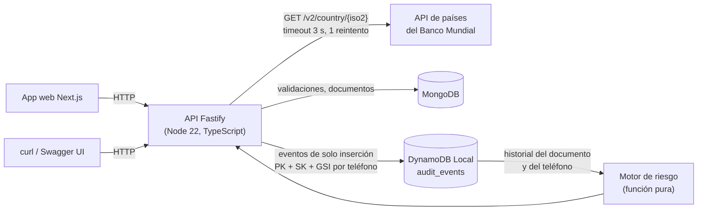
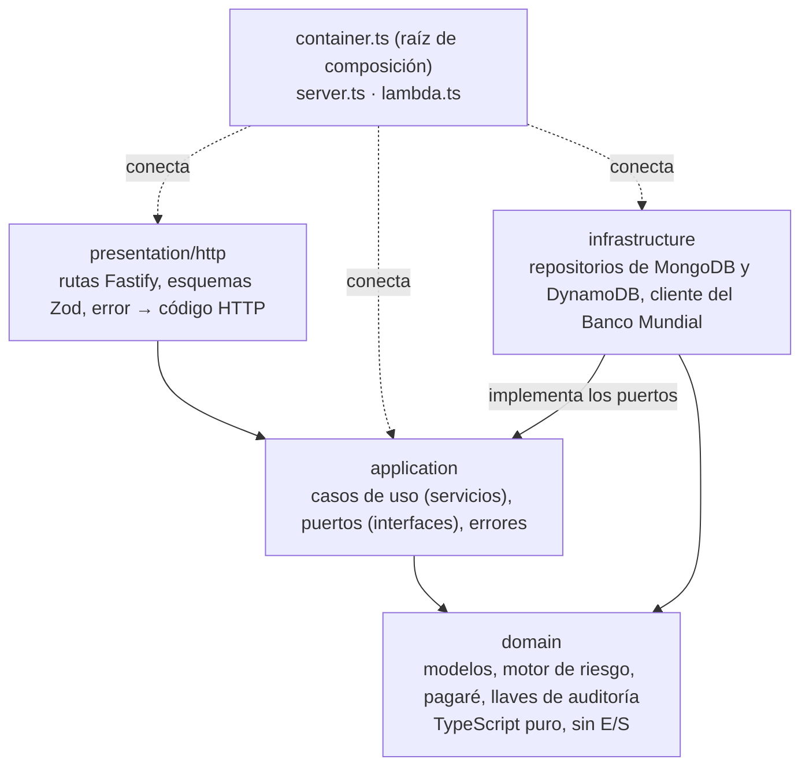
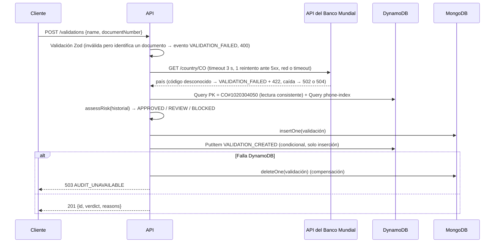
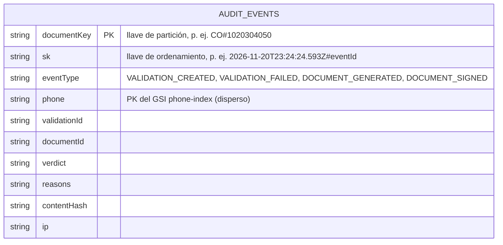

# Servicio de validación de identidad

**Español** · [English](README.en.md)

Prueba técnica para AUCO (Full Stack, Node.js). Un servicio en Node.js que valida a una persona, enriquece el registro con datos públicos de su país, lo guarda en **MongoDB** y escribe una auditoría de solo inserción en **DynamoDB Local**.

Sobre los endpoints obligatorios crece hasta una pequeña «notaría digital», inspirada en el camino que siguió AUCO: **validar → evaluar el riesgo → generar un documento → firmar → auditar**. Todo lo que va más allá del enunciado es opcional, tiene sus propias pruebas y no cambia el contrato pedido.

| Lo que pide el enunciado | Dónde |
|---|---|
| `POST /validations`: nombre + documento → API pública → MongoDB → id | [`validation-service.ts`](api/src/application/validation-service.ts) |
| `GET /validations/:id` | igual |
| Evento de auditoría en DynamoDB Local con llave por documento y fecha | [`dynamo-audit-repository.ts`](api/src/infrastructure/persistence/dynamo-audit-repository.ts) |
| Validación de entradas | Esquemas Zod, [`schemas.ts`](api/src/presentation/http/schemas.ts) |
| Manejo de errores de la API externa | [`world-bank-countries-client.ts`](api/src/infrastructure/countries/world-bank-countries-client.ts) |
| Al menos 3 pruebas automatizadas | 66 pruebas unitarias y HTTP + 5 de integración contra MongoDB y DynamoDB reales |
| README | este archivo |

| Extra | Dónde |
|---|---|
| Reintentos seguros con el header `Idempotency-Key` | [`idempotency-service.ts`](api/src/application/idempotency-service.ts) |
| Motor de riesgo (APPROVED / REVIEW / BLOCKED) sobre la auditoría | [`risk-engine.ts`](api/src/domain/risk-engine.ts) |
| Pagaré con firma que detecta manipulaciones | [`document-service.ts`](api/src/application/document-service.ts) |
| Endpoint con la línea de tiempo de auditoría | [`audit-routes.ts`](api/src/presentation/http/routes/audit-routes.ts) |
| Front en Next.js *mobile first* para todo el flujo, en español e inglés, modo claro y oscuro | [`web/`](web) |
| Documentación OpenAPI, CI, handler para Lambda, script de demo | `/docs`, [`.github/workflows`](.github/workflows/ci.yml), [`lambda.ts`](api/src/lambda.ts), [`scripts/demo.sh`](scripts/demo.sh) |

## Video

[](https://drive.google.com/file/d/1IghtpW329I2ZsyTsirISBGvDyeM-zsp1/view)

Recorrido de 39 s por el flujo, armado en código (Remotion) sobre capturas reales de la app web, con voz generada con ElevenLabs. En el video el producto lleva el nombre de *Constata*. [Ver en 16:9](https://drive.google.com/file/d/1IghtpW329I2ZsyTsirISBGvDyeM-zsp1/view) · [Ver en vertical 9:16](https://drive.google.com/file/d/1KcqEdP51o7aAHdvfoK083pyNo14Jiabx/view). Música: *Heads Will Roll (A-Trak Remix)*, Yeah Yeah Yeahs.

## Inicio rápido

Requisitos: Docker con Compose y acceso a internet (el servicio consulta la API del Banco Mundial).

```bash
docker compose up --build
```

| Qué | URL |
|---|---|
| App web | http://localhost:3001 |
| API | http://localhost:3000 |
| OpenAPI / Swagger UI | http://localhost:3000/docs |
| Health (revisa MongoDB y la tabla de DynamoDB) | http://localhost:3000/health |

¿Algún puerto ocupado? Todos los puertos del host se pueden cambiar:

```bash
API_PORT=3100 WEB_PORT=3101 MONGO_PORT=27019 DYNAMO_PORT=8002 docker compose up --build
```

Después, el recorrido completo (todos los escenarios, incluidos los errores):

```bash
scripts/demo.sh                          # o: scripts/demo.sh http://localhost:3100
```

## Arquitectura



### Capas

La API sigue una arquitectura por capas (puertos y adaptadores). Las dependencias solo apuntan hacia adentro y **ESLint lo hace cumplir** (`no-restricted-imports` por capa en [`eslint.config.js`](api/eslint.config.js)): un import prohibido rompe el lint y el CI.



| Capa | Conoce | No puede importar |
|---|---|---|
| `domain/` | solo a sí misma | ninguna otra capa, Fastify, MongoDB, AWS SDK, Zod |
| `application/` | domain | infrastructure, presentation, ningún framework ni base de datos |
| `presentation/http/` | application, domain | infrastructure, MongoDB, AWS SDK |
| `infrastructure/` | puertos y errores de application, domain | presentation, Fastify |

- **Los errores de la aplicación llevan un código, no un estado HTTP.** Solo [`error-handler.ts`](api/src/presentation/http/error-handler.ts) los traduce a 404, 409, 422, 502, 503 o 504.
- **Los puertos** ([`ports.ts`](api/src/application/ports.ts)) son lo que necesitan los casos de uso: repositorios, el cliente de países, el almacén de idempotencia y un logger. La infraestructura los implementa y las pruebas los implementan en memoria.
- **La raíz de composición** ([`container.ts`](api/src/container.ts)) es el único módulo que conoce todas las capas. Por eso cambiar REST Countries por el Banco Mundial tocó un solo adaptador, las pruebas corren la app real con dobles en memoria en menos de un segundo, y [`lambda.ts`](api/src/lambda.ts) corre la misma app detrás de API Gateway con `@fastify/aws-lambda` (no se despliega en este ejercicio).

## API

| Método | Ruta | Qué hace |
|---|---|---|
| `POST` | `/validations` | Valida, enriquece, evalúa el riesgo, guarda y audita. `201 {id, verdict, reasons}` |
| `GET` | `/validations/:id` | El registro guardado |
| `GET` | `/audit/:countryCode/:documentNumber` | Todos los eventos de auditoría de un documento, del más antiguo al más reciente |
| `POST` | `/validations/:id/promissory-notes` | Genera un pagaré de demostración (solo si es APPROVED) |
| `POST` | `/documents/:id/sign` | Lo firma (hora, IP, user agent y verificación del hash) |
| `GET` | `/documents/:id` | El documento, su hash y su firma |
| `GET` | `/health` | Ping a MongoDB y revisión de la tabla de DynamoDB |

### `POST /validations`

```bash
curl -X POST localhost:3000/validations \
  -H 'content-type: application/json' \
  -d '{"name": "Ana Gómez", "documentNumber": "1020304050"}'
# 201 {"id":"6b00d6a86152ee9615a08a52","verdict":"APPROVED","reasons":[]}
```

| Campo | Obligatorio | Reglas |
|---|---|---|
| `name` | sí | 2 a 100 caracteres, sin espacios sobrantes |
| `documentNumber` | sí | 5 a 20 letras o dígitos; se quitan `.`, `-` y espacios (`1.020.304.050` → `1020304050`) |
| `countryCode` | no, por defecto `CO` | ISO 3166-1 alfa-2; se usa para enriquecer el registro |
| `phone` | no | E.164, p. ej. `+573001234567`; alimenta la señal de teléfono compartido |

El enunciado pide *nombre y documento*, así que esos son los únicos campos obligatorios: un `curl` con solo esos dos funciona. El país y el teléfono son extras opcionales.

#### Reintentos seguros: `Idempotency-Key`

Un reintento por la red o un doble clic no debe crear dos validaciones (ni dos eventos de auditoría). Basta con enviar el header `Idempotency-Key`, cualquier cadena única generada por el cliente (por ejemplo, un UUID), según el borrador de la IETF *The Idempotency-Key HTTP Header Field*:

```bash
KEY=$(uuidgen)
curl -X POST localhost:3000/validations -H "Idempotency-Key: $KEY" \
  -H 'content-type: application/json' -d '{"name": "Ana Gómez", "documentNumber": "1020304050"}'
# La misma petición otra vez: mismo id, header "Idempotent-Replayed: true", no se escribe nada nuevo
```

| Situación | Respuesta |
|---|---|
| Misma llave, mismo cuerpo (después de normalizar: `1.020.304.050` = `1020304050`) | La primera respuesta otra vez, con `Idempotent-Replayed: true` |
| Misma llave, otro cuerpo | `422 IDEMPOTENCY_KEY_REUSED` |
| Misma llave mientras la primera petición sigue en curso (doble clic) | `409 IDEMPOTENCY_REQUEST_IN_PROGRESS` |
| La operación falló (p. ej. 502) | Se libera la llave para que el cliente pueda reintentar con ella |
| Sin el header | Comportamiento normal: cada petición crea una validación |

Las llaves viven en MongoDB: se reclaman con un `insertOne` atómico sobre un `_id` único (de dos peticiones simultáneas gana exactamente una), un índice TTL las borra a las 24 horas y un reclamo abandonado durante 30 s (un proceso que se cayó) se puede retomar. La app web envía una llave nueva en cada intento y la reutiliza cuando el usuario reintenta los mismos datos.

### `GET /validations/:id`

```json
{
  "id": "6b00d6a86152ee9615a08a52",
  "name": "Ana Gómez",
  "documentNumber": "1020304050",
  "countryCode": "CO",
  "phone": null,
  "country": {
    "code": "CO",
    "name": "Colombia",
    "region": "Latin America & Caribbean",
    "incomeLevel": "Upper middle income",
    "capital": "Bogota"
  },
  "risk": { "verdict": "APPROVED", "reasons": [] },
  "createdAt": "2026-11-20T23:24:24.593Z"
}
```

Los datos del país vienen en inglés porque así los devuelve el Banco Mundial.

### Errores

Todos los errores tienen la misma forma, `{"error": {"code": "...", "message": "...", "details": [...]}}`, y cada respuesta lleva un header `x-request-id` que también aparece en los logs. Los mensajes de la API van en inglés porque son parte de su contrato.

| Estado | Código | Cuándo |
|---|---|---|
| 400 | `VALIDATION_ERROR` | Cuerpo o id inválido, con `details` por campo |
| 404 | `NOT_FOUND` | No existe una validación o un documento con ese id |
| 409 | `VALIDATION_NOT_APPROVED`, `ALREADY_SIGNED`, `DOCUMENT_TAMPERED` | Reglas de los documentos |
| 409 | `IDEMPOTENCY_REQUEST_IN_PROGRESS` | La misma `Idempotency-Key` aún se está procesando |
| 422 | `COUNTRY_NOT_FOUND` | La API de países no reconoce el código |
| 422 | `IDEMPOTENCY_KEY_REUSED` | La misma `Idempotency-Key` con otro cuerpo |
| 502 | `UPSTREAM_UNAVAILABLE` | Falló la API de países (después de un reintento) |
| 503 | `AUDIT_UNAVAILABLE` | Falló DynamoDB; se deshizo la escritura en MongoDB |
| 504 | `UPSTREAM_TIMEOUT` | La API de países tardó más de 3 s (después de un reintento) |

## Cómo se crea una validación



**No existe una validación sin su evento de auditoría.** El id se genera antes de escribir, el registro va a MongoDB y después el evento a DynamoDB. Si DynamoDB falla, se borra lo insertado en MongoDB y la API responde 503. En producción se usaría un *outbox* o DynamoDB Streams en lugar de un borrado compensatorio (ver *Qué mejoraría*).

## Diseño de llaves en DynamoDB



| Patrón de acceso | Cómo |
|---|---|
| Todo el historial del documento de una persona, en orden | `Query documentKey = :pk` (una partición, ordenada por `sk`) |
| Eventos en un rango de tiempo | `Query documentKey = :pk AND sk BETWEEN :from AND :to` |
| Todos los documentos que usaron un teléfono | `Query` sobre el GSI `phone-index` |
| Nunca sobrescribir un evento | `PutItem` con `attribute_not_exists(documentKey) AND attribute_not_exists(sk)` |

- **PK `documentKey = "<país>#<documento>"`**: el enunciado pide una llave «por documento». El país va en la llave porque un mismo número puede ser de dos personas distintas en dos países (una *cédula* colombiana y un *DNI* peruano). Todos los eventos de una persona quedan en una sola partición, que es justo lo que leen el motor de riesgo y la línea de tiempo.
- **SK `sk = "<fecha ISO-8601>#<eventId>"`**: las fechas ISO se ordenan como texto, así que la partición sale en orden cronológico y admite consultas por rango. El sufijo `eventId` evita que dos eventos del mismo milisegundo choquen. Los eventos de un mismo milisegundo se tratan como concurrentes: su orden relativo no tiene significado.
- **GSI `phone-index`** (PK `phone`, SK `sk`): sirve la señal de «mismo teléfono en varias personas». Es disperso: solo se indexan los eventos que tienen teléfono.
- **Consistencia**: el historial del documento usa `ConsistentRead`, así que el motor siempre ve el evento anterior. Los GSI solo admiten lecturas eventualmente consistentes, algo aceptable para una señal que solo pide revisión.
- DynamoDB Local persiste en un volumen de Docker: una auditoría debe sobrevivir a los reinicios.

## Motor de riesgo

Una función pura de la capa de dominio ([`risk-engine.ts`](api/src/domain/risk-engine.ts)): recibe el historial ya leído de DynamoDB y devuelve un veredicto con motivos legibles. Las reglas se inspiran en las señales de fraude que AUCO publicó en septiembre de 2026.

| Señal | Regla | Veredicto |
|---|---|---|
| `DOCUMENT_NAME_MISMATCH` | El documento ya se validó con otro nombre (sin importar mayúsculas ni tildes) | `REVIEW` |
| `SHARED_PHONE` | El teléfono está ligado a otros documentos | `REVIEW`; `BLOCKED` desde 3 |
| `REPEATED_FAILURES` | 3 o más intentos fallidos del documento en las últimas 24 h | `BLOCKED` |

Gana el veredicto más grave y se devuelven todos los motivos. Un *intento fallido* es una petición que identifica un documento (número y país válidos) pero no pasa la validación, o que usa un país que no existe. Las caídas de la API externa no son culpa de la persona y no cuentan. Los umbrales son arbitrarios y están en una sola constante.

Las validaciones en `REVIEW` y `BLOCKED` se guardan igual (por trazabilidad), pero no pueden generar documentos.

## Documentos y firma

```bash
curl -X POST localhost:3000/validations/<validationId>/promissory-notes \
  -H 'content-type: application/json' \
  -d '{"amount": 1500000, "dueDate": "2027-06-30", "creditorName": "Banco Demo S.A."}'
curl -X POST localhost:3000/documents/<documentId>/sign
```

- El pagaré se llena con la identidad validada. La moneda por defecto es COP y la ciudad, la capital que devuelve la API de países. Está en español porque es un *pagaré* colombiano, y lleva la marca de documento de demostración sin validez legal.
- Su SHA-256 se escribe en la **auditoría inmutable** cuando se genera. Al firmar se recalcula el hash y se compara con la copia de la auditoría, no con la que está guardada junto al documento. Un documento editado después en MongoDB, aunque también se actualice su hash guardado, se rechaza con `409 DOCUMENT_TAMPERED`.
- El paso `PENDING_SIGNATURE → SIGNED` es un `updateOne` condicional, así que dos clics simultáneos no pueden firmar dos veces (`409 ALREADY_SIGNED`).
- La firma guarda la hora, la IP, el user agent y el tiempo transcurrido desde la validación (la app web lo muestra como un cronómetro).

## App web

[`web/`](web) es un flujo tipo *onboarding* en Next.js 16 + Tailwind 4, con una pregunta por pantalla: país → identidad → veredicto de riesgo → pagaré y firma → auditoría.

- **Mobile first:** los estilos base son para el celular (barra de progreso compacta, acciones fijas abajo, inputs de 16 px); desde `lg` aparece un panel lateral con los pasos.
- **Español e inglés:** diccionarios tipados en [`lib/i18n`](web/lib/i18n). `es.ts` tiene el tipo de `en.ts`, así que una clave faltante o sobrante rompe el build. El idioma inicial sale del navegador y la elección se guarda.
- **Claro y oscuro:** los colores son variables CSS que cambian con `data-theme` en `<html>`; la preferencia (claro, oscuro o la del sistema) se guarda, y un script mínimo la aplica antes de pintar, así que no hay destello blanco.

## Qué es real y qué es simulado

| Real | Simulado o fuera de alcance |
|---|---|
| Validación de entradas, enriquecimiento con el Banco Mundial, MongoDB, auditoría en DynamoDB, reglas de riesgo, hash SHA-256, registro de la firma, idempotencia | Foto del documento, prueba de vida, Registraduría y listas restrictivas, envío por WhatsApp o correo, firma criptográfica (PKI), autenticación |

## Pruebas

```bash
cd api && npm ci
npm test                 # 66 pruebas unitarias y HTTP, dobles en memoria, sin Docker (< 1 s)
npm run lint && npm run typecheck

docker compose up -d mongo dynamodb
npm run test:e2e         # 5 pruebas de integración contra MongoDB y DynamoDB Local reales
```

- **Unitarias:** esquemas, cliente de países (mapeo de la respuesta, código desconocido, agregados regionales, reintento, timeout, caché), reglas de riesgo, pagaré, idempotencia.
- **HTTP** (`app.inject`, la app Fastify real con dobles): todos los códigos de estado de arriba, la reversión en MongoDB cuando falla DynamoDB, la auditoría de intentos fallidos, el flujo de documentos, la detección de manipulaciones, los reintentos idempotentes y el doble clic.
- **Integración:** `Query` cronológica por llave de partición, el GSI por teléfono, escrituras condicionales que no sobrescriben, un solo ganador entre firmas simultáneas y entre reclamos de idempotencia simultáneos (más el índice TTL).
- El CI (GitHub Actions) corre lint, tipos, todas las pruebas con MongoDB y DynamoDB como contenedores de servicio, y los dos builds.

## Estructura del proyecto

```
api/src/
  domain/                     modelos, motor de riesgo, pagaré, llaves de auditoría (puro)
  application/                casos de uso: validación, documentos, auditoría, idempotencia; puertos; errores
  infrastructure/
    countries/                cliente del Banco Mundial: timeout, reintento, caché, mapeo de errores
    persistence/              repositorios de MongoDB y DynamoDB, almacén de idempotencia (implementan los puertos)
  presentation/http/          app Fastify, rutas, esquemas Zod, manejador de errores
  container.ts                raíz de composición
  server.ts · lambda.ts       puntos de entrada (contenedor / AWS Lambda)
api/test/                     pruebas unitarias y HTTP; test/e2e, pruebas de integración
web/                          front en Next.js 16 + Tailwind, mobile first, español e inglés
scripts/demo.sh               recorrido con curl por todos los escenarios
```

## Decisiones y compromisos

- **API del Banco Mundial en lugar de REST Countries.** REST Countries fue la primera opción, pero la `v3.1` ahora responde con un aviso de deprecación y la `v5` exige una API key, lo que obligaría a cada evaluador a registrarse. La API del Banco Mundial es gratuita, oficial y no pide llave. Sus rarezas están manejadas y probadas: los códigos desconocidos responden **HTTP 200** con un mensaje de error, y los agregados regionales (p. ej. `ZJ`) parecen países.
- **Un solo reintento y solo ante fallas transitorias** (red, 5xx, timeout), nunca ante «el país no existe». Con un timeout de 3 s, el peor caso ronda los 6 s. Las consultas se guardan en caché en memoria durante una hora, porque los datos de un país casi no cambian.
- **Fastify + Zod.** Un mismo esquema valida la entrada, tipa el handler y genera la documentación OpenAPI.
- **Compensación en lugar de transacción.** MongoDB y DynamoDB no pueden compartir una transacción. El borrado compensatorio es simple y se puede probar; el costo es una ventana corta en la que una caída podría dejar un registro sin su evento.
- **Se auditan los intentos fallidos, no las caídas de la API externa.** Si no, una caída del Banco Mundial bloquearía a personas legítimas.

## Limitaciones conocidas

Las encontró una revisión del código y se dejaron a propósito, porque resolverlas exige autenticación, que está fuera del alcance:

- **Los intentos fallidos se pueden falsificar.** Cualquiera puede enviar tres peticiones inválidas con el número de documento de otra persona y dejar ese documento `BLOCKED` durante 24 horas. Con API keys por empresa, los fallos se contarían por cliente.
- **La línea de tiempo de auditoría es pública.** `GET /audit/...` devuelve nombres, teléfonos e IP de firma para cualquier número de documento. En producción exigiría autenticación y una verificación de permisos por empresa.
- **La API del Banco Mundial omite algunos códigos ISO reales** (p. ej. `TW`, `AQ`), que reciben `422 COUNTRY_NOT_FOUND` («no reconocido por la API de países»).

## Qué mejoraría con más tiempo

- **Outbox o DynamoDB Streams** en lugar del borrado compensatorio, para cerrar la ventana de caída.
- **Carrera en la evaluación de riesgo:** dos validaciones simultáneas del mismo documento leen el historial antes de que alguna escriba. Una escritura condicional sobre un contador por documento la cerraría.
- **Modo degradado:** guardar la validación con `enrichment: null` y reintentar en segundo plano cuando la API de países esté caída, en vez de rechazarla.
- **Despliegue real:** Lambda + API Gateway con infraestructura como código (SAM o CDK), logs estructurados y métricas por llamada externa.
- **Autenticación y multi-tenancy** (API keys por empresa), lo que además resuelve las limitaciones de arriba, y un historial de riesgo compartido entre empresas, al estilo del Identity Guardian de AUCO.
- **Firma PKI** y sello de tiempo certificado en lugar de un hash registrado.
- **Umbrales de riesgo configurables** y un flujo de revisión para pasar un caso de `REVIEW` a `APPROVED`.

## Correr sin Docker

```bash
docker compose up -d mongo dynamodb           # o tu propio MongoDB y DynamoDB Local
cd api && cp .env.example .env && npm ci && node --env-file=.env --import tsx src/server.ts
cd web && npm ci && npm run dev               # http://localhost:3001
```
